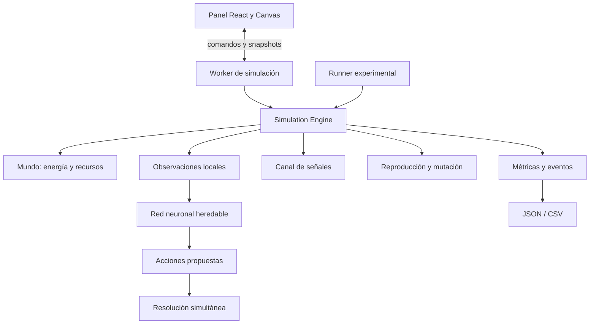

# SYN-003 — Arquitectura técnica (propuesta v0.2)

> Estado: diseño para revisión; **no implementado**. Las decisiones de comportamiento D1–D6 ya están aprobadas.

## 1. Objetivos de arquitectura
1. Motor determinista, independiente del renderizado y reutilizable en navegador o pruebas CLI.
2. Experimentos reproducibles con semilla, versión de motor y configuración.
3. Separar percepción, red neuronal, evolución, propagación de señales y métricas.
4. Facilitar experimentos A/B/controles sin duplicar implementaciones ni alterar reglas inadvertidamente.
5. Mantener una UI reactiva mientras se acelera la simulación.

## 2. Stack propuesto
- **Monorepo TypeScript**, gestor de paquetes a decidir (npm workspaces es suficiente).
- **Core TypeScript puro**, sin React, DOM, acceso a red ni reloj del sistema.
- **Web React + Vite** como alternativa sencilla a Next.js (no es necesario SSR).
- **Canvas 2D** de inicio; WebGL solo después de medir cuello de botella.
- **Web Worker** para ejecutar la simulación fuera del hilo principal.
- **Vitest** para pruebas unitarias, de determinismo y de integración.
- **Persistencia local inicial** por importación/exportación JSON/CSV; no base de datos en MVP.

## 3. Diagrama de módulos



## 4. Estructura prevista
```text
apps/
  web/                 # UI React, Canvas, controles, inspector
packages/
  simulation/          # Estado, ticks, mundo, recursos y física simplificada
  agents/              # Observaciones, red neuronal y genotipos
  signals/             # Emisión, propagación y recepción
  experiments/         # Condiciones, réplicas, comparativas y exportación
  shared/              # Tipos, esquemas y validación de configuración
docs/                  # Especificaciones, decisiones y resultados
```
La estructura es orientativa; evitar paquetes artificialmente pequeños si introducen ciclos o complejidad.

## 5. Contratos de datos

### SimulationConfig (inmutable, serializable y versionado)
- `schemaVersion`, `engineVersion`, `seed`, `durationTicks`.
- `world: {width, height, toroidal: true}`.
- `population: {initialCount, maxCount, maxAge, reproductionThreshold, mutationRate}`.
- `energy: {basalCost, moveCost, signalCost, foodValue}`.
- `sensing: {foodRadius, hazardRadius, neighborRadius, signalRadius}`.
- `environment: {foodSpawnRate, foodClusters, staticHazards}`.
- `signals: {mode: active|disabled|shuffled, attenuation}`.
- `policy: {topology, normalization}`.

### AgentState
`id, parentId, generation, x, y, heading, energy, age, genome, alive`. Genoma: vector numérico de parámetros y pesos neuronales. Los identificadores se asignan determinísticamente.

### Observation
Vector normalizado de sensores locales (alimento, riesgo, vecinos, energía y señales) con orden y límites fijos. **Nunca** incluir contexto global, etiquetas de señales o estado futuro.

### Action
Movimiento/orientación, intento de consumo, intensidad de señal [-1,1], intento de reproducción; el resolver aplica costes, límites y reglas de conflicto.

### SimulationState
`tick, rngState, agents, food, hazards, counters`. Los estados serializados contienen lo necesario para continuar sin alterar el resultado.

### SimulationEvent / ExperimentResult
Eventos con `tick, type, actorId, payload` y resultados con `config, engineVersion, seed, condition, metrics, checksum`. La telemetría detallada se activa por configuración.

## 6. Ciclo del tick
1. Congelar snapshot lógico del tick anterior y calcular observaciones locales.
2. Evaluar políticas neuronales para todos los agentes sobre dicho snapshot.
3. Resolver movimientos y costes en lote, sin favorecer al primero en el array.
4. Resolver consumo de alimento y exposición al riesgo con desempates mediante PRNG.
5. Resolver reproducción, mutaciones, nacimientos y muertes.
6. Aplicar generación/reposición de recursos según parámetros.
7. Registrar eventos y acumular métricas; producir snapshot visual a una frecuencia independiente.

### Particularidad del canal
La señal recibida en tick `t` procede de emisiones del tick `t-1`. Así evitamos dependencias circularmente instantáneas y efectos del orden de evaluación. La atenuación usa distancia toroidal.

## 7. Evolución y políticas
- Una arquitectura neuronal pequeña compartida en topología; pesos heredados con mutación en reproducción asexual.
- No hay etiquetas de salida como «alarma» o «comida»: el canal es una salida numérica.
- Política inicial sin aprendizaje online: cambios por selección y mutación. El aprendizaje individual queda fuera del MVP.
- Separar `observe()`, `evaluateGenome()`, `mutate()` y `resolveActions()` para permitir comparativas y reemplazo del modelo.
- Registrar parámetros exactos de normalización, inicialización y mutación en cada experimento.

## 8. Modos experimentales
- `active`: señales gobernadas por las salidas de los agentes.
- `disabled`: no se perciben señales; documentar y controlar efectos de coste energético.
- `shuffled`: señales recibidas desacopladas de sus emisores/contextos conservando en lo posible distribución de intensidades y coste.
- El runner ejecuta réplicas con semillas declaradas, genera resúmenes estadísticos y exporta metadatos.
- Aislar fuentes PRNG (mundo, agente, reproducción, controles) para que una condición no desplace aleatoriamente toda la simulación al consumir una muestra adicional.

## 9. Contrato Worker ↔ UI
Comandos `initialize(config)`, `start()`, `pause()`, `step(n)`, `setSpeed(multiplier)`, `reset(config)`, `exportResults()`.
Respuestas `ready`, `snapshot`, `metrics`, `progress`, `completed`, `error`.
Validar esquema de mensajes. El worker gobierna los ticks; UI controla únicamente ejecución/representación. Renderizar estados muestreados, no todos los ticks acelerados.

## 10. Persistencia y rendimiento
- Primero exportaciones JSON de configuración/estado/resultados y CSV de series.
- Eventos detallados bajo demanda y buffers acotados; no almacenar cada fotograma.
- Indexación espacial sencilla (cuadrícula de vecinos) si el coste O(n²) de sensores se vuelve significativo.
- Perf targets provisionales: >= 100 agentes y 10.000 ticks sin bloquear la UI; medir tiempo por tick y memoria, sin prometer una cifra de FPS.
- No fijar infraestructura cloud ni base de datos hasta tener evidencia de necesidad.

## 11. Seguridad, calidad y pruebas
- Configuraciones validadas y límites de valores para impedir bucles, NaN o tamaños incontrolados.
- Sin ejecución de código aportado por usuario.
- Pruebas de invariantes (energía, posiciones toroidales, edades, capacidad de población), PRNG y reproducción exacta.
- Pruebas de regresión con semillas fijas, checksums y diferentes velocidades de render.
- Pruebas de control de señales (emisiones deshabilitadas, atenuación, coste, perturbación).
- Tests de límites de arrays y mutaciones; CI: lint + tests + build.

## 12. Decisiones para aprobar antes de implementar
A. Stack: Vite + React + TypeScript, core puro, Canvas 2D y Worker.
B. Evolución genética sin aprendizaje individual en MVP.
C. Señales recibidas con retraso de un tick.
D. Exportaciones locales sin base de datos inicialmente.
E. Aislamiento de PRNG y contratos versionados para reproducibilidad.

SYN-004 definirá la metodología experimental cuantitativa antes de interpretar los resultados.
